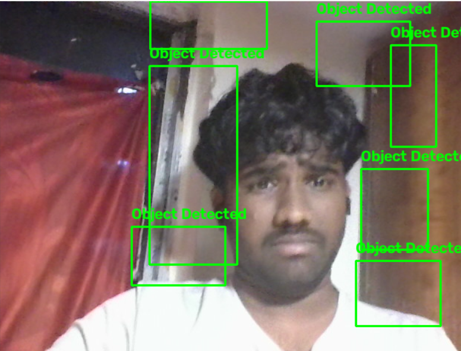

# Workshop 2 – Object Detection Using Web Camera

## Name
MUTHUAKASH M

## Register Number
212225230194

## Aim
To detect moving foreground objects using a web camera and OpenCV by applying background subtraction, morphological operations, contour detection, and bounding boxes.

## Software Required
- Python
- Jupyter Notebook
- OpenCV (cv2)

## Hardware Required
- Computer or laptop
- Working web camera

## Algorithm

1. Import the OpenCV library.
2. Open the web camera using `cv2.VideoCapture(0)`.
3. Create a background subtractor using `cv2.createBackgroundSubtractorMOG2()` with history 500, variance threshold 50, and shadow detection enabled.
4. Read frames continuously from the web camera.
5. If a frame cannot be read, display an error message and stop the loop.
6. Apply background subtraction to create a foreground mask.
7. Create a 5 × 5 elliptical structuring element.
8. Apply morphological opening to remove small noise.
9. Apply dilation to make foreground regions more visible.
10. Find the external contours in the foreground mask.
11. Calculate the area of each contour and ignore regions with an area of 2500 pixels or less.
12. Find the bounding rectangle for each remaining contour.
13. Draw a green rectangle and display the text "Object Detected".
14. Display the camera frame continuously.
15. Press `q` to stop the program.
16. Release the web camera and close all OpenCV windows.

## Python Program

```python
import cv2

# Open the web camera
cap = cv2.VideoCapture(0)

# Background subtractor for foreground-object detection
bg_subtractor = cv2.createBackgroundSubtractorMOG2(
    history=500,
    varThreshold=50,
    detectShadows=True
)

while True:

    # Read frame from webcam
    ret, frame = cap.read()

    if not ret:
        print("Cannot read frame from web camera")
        break

    # Create foreground mask
    mask = bg_subtractor.apply(frame)

    # Remove small noise
    kernel = cv2.getStructuringElement(
        cv2.MORPH_ELLIPSE,
        (5, 5)
    )

    mask = cv2.morphologyEx(
        mask,
        cv2.MORPH_OPEN,
        kernel
    )

    mask = cv2.morphologyEx(
        mask,
        cv2.MORPH_DILATE,
        kernel
    )

    # Find contours of detected objects
    contours, _ = cv2.findContours(
        mask,
        cv2.RETR_EXTERNAL,
        cv2.CHAIN_APPROX_SIMPLE
    )

    # Process each detected contour
    for contour in contours:

        area = cv2.contourArea(contour)

        if area > 2500:

            x, y, w, h = cv2.boundingRect(contour)

            # Draw bounding box
            cv2.rectangle(
                frame,
                (x, y),
                (x + w, y + h),
                (0, 255, 0),
                2
            )

            # Display detection text
            cv2.putText(
                frame,
                "Object Detected",
                (x, y - 10),
                cv2.FONT_HERSHEY_SIMPLEX,
                0.7,
                (0, 255, 0),
                2
            )

    # Display camera frame
    cv2.imshow(
        "Workshop 2 - Object Detection",
        frame
    )

    # Press q to stop
    if cv2.waitKey(1) & 0xFF == ord('q'):
        break

# Release the webcam
cap.release()

# Close all OpenCV windows
cv2.destroyAllWindows()
```

## Output



## Result

Thus, foreground object detection using a web camera was implemented successfully using OpenCV. The program applies background subtraction and morphological operations, detects contours, and draws bounding boxes around foreground regions larger than 2500 pixels.
